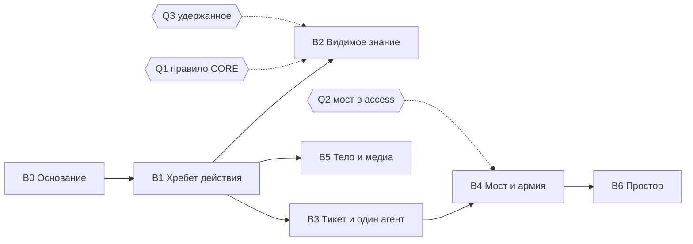

# План интерфейса Древа для работы с агентами

Дата: 20 ноября 2026. Рабочая база: `main` → `56b5ec94b776238677c317f9c5d495520ad13d02`.
Каждая волна начинается со свежего `main`.

Этот документ задаёт стратегию, порядок и правила исполнения для 67 предложений
по интерфейсу. Он продолжает результаты
[плана полного ядра бонсая](../../bonsai/IMPLEMENTATION_PLAN.md) (общий индекс,
адреса полей, три режима, познавательная сессия) и не возобновляет его
остановленный перенос содержания в ToS.

Основную модель переключает Дионис. При смене модели точкой продолжения служат
этот документ, текущая ветка, последний рабочий commit, раздел
[«Состояние исполнения»](#состояние-исполнения) и запись
[«Горизонта»](#горизонт-новые-перспективы).

## Назначение и граница

Интерфейс делается для одного человека с его агентами: от одного агента рядом до
армии в пятьсот и больше активных. Человек читает, исследует, ставит задачи,
рассматривает вернувшееся и видит работу агентов прямо в пространстве Древа.
Агентная поверхность оставляет простор для игры и воображения внутри явной
системы правил: правила уточняют простор и служат основанием роста.

Вне этого плана:

- турниры, судейские коллегии, рейтинги, карточки участников, сервер для данных
  других людей;
- запись в `ToS/`, канон, рассмотрение от имени Древа; перенос P7 остановлен
  до осмотра бонсая и отдельного решения Диониса;
- авторская правка содержания бонсая из интерфейса. Интерфейс готовит пакет
  правок; применяет его владелец через свой маршрут.

Всё, что интерфейс создаёт (тикеты, ветки, нити, решения рассмотрения, записи
агентов), остаётся личной локальной работой с тем же статусом, что нынешняя
рабочая область: «never writes ToS source, review, rights, or canon»
([research-workspace.v1](../contracts/research-workspace.v1.schema.json)).

## Что продумано заранее

Эти решения приняты до начала работ, потому что на них стоят все 67 предложений.
Отступление от любого из них сначала записывается в «Горизонт».

### 1. Два яруса одной поверхности

| | Ярус 0: браузер | Ярус 1: мост |
| --- | --- | --- |
| Для кого | человек и один-несколько агентов | человек и сотни агентов |
| Хранилище действий | IndexedDB страницы | явно выбранное личное хранилище у процесса `tos` |
| Подключение агентов | WebMCP, ручной пакет | MCP у моста; страница получает сводный поток |
| Кто исполняет адресные команды | страница | мост |

Оба яруса читают один договор записи действия и исполняют одни правила. Правила
живут в Rust и собираются и нативно, и в WASM, как уже устроен
[`tos-web-rules`](../../rust/crates/tos-web-rules/README.md); JavaScript остаётся
тонким адаптером. Страница видит мост как замену собственного хранилища: тот же
интерфейс чтения, подписки и записи. Поэтому всё, что построено на ярусе 0,
переходит на ярус 1 сменой адаптера.

Мост — это режим существующего процесса `tos` с явно выбранным личным хранилищем,
по образцу `--exploration-checkpoints` в [Access](../README.md). Отдельного
сервиса нет. Сторона чтения уже нацелена на сотни одновременных агентных клиентов
([TOS-D-0069](../../docs/decisions/TOS-D-0069-rust-execution-foundation.md),
[TOS-D-0074](../../docs/decisions/TOS-D-0074-measured-mechanisms-and-plain-governance.md)).

### 2. Запись действия

Единица всей личной и агентной работы — неизменяемая запись действия. Тикет,
предложение, заметка, ответ агента, решение рассмотрения, аренда места, объявление
нового вида, передача наружу и возврат — виды одной записи.

Обязательное у каждой записи (инварианты, предложение L1):

| Поле | Смысл |
| --- | --- |
| идентификатор и порядковый номер хранилища | устойчивый адрес записи и порядок |
| вид | имя в открытом пространстве имён |
| автор | человек, агент или смешанно; для агента его идентификатор, модель, роль, отряд, сессия |
| цели | адреса предметов, к которым относится действие |
| основания | точные места в источниках и адреса предметов; пусто только там, где вид это объявил |
| намерение | одна читаемая строка |
| тело | поля вида; неизвестные поля сохраняются и показываются общим способом |
| родители и замена | из чего выросло; какую запись заменяет |
| время и отпечаток | отпечаток по каноническим байтам ([TOS-D-0075](../../docs/decisions/TOS-D-0075-jcs-canonical-bytes.md)) |

Свойства:

- Запись не изменяется. Исправление и отмена — новая запись со ссылкой на прежнюю.
- Состояние (статус тикета, очередь рассмотрения, занятость места, присутствие
  агентов) нигде не хранится отдельно: оно вычисляется свёрткой журнала. Доска,
  рассмотрение, повтор работы агента, пульт армии — разные свёртки одного журнала.
- Каждая запись несёт постоянную отметку личной локальной работы: не источник,
  не рассмотрено Древом, не канон.
- Список видов открыт. Агент может объявить новый вид записью объявления с его
  формой; интерфейс показывает неизвестный вид общим способом.

Нынешняя рабочая область (`tos_research_workspace_session_v1`) остаётся владельцем
мыслей и предложений. Её журнал зеркалируется в журнал действий адаптером.
Условие удаления адаптера: рабочая область читает собственное состояние из
журнала действий.

### 3. Два класса команд

| | Указательные | Адресные |
| --- | --- | --- |
| Зависят от | того, что сейчас выбрал человек | явного адреса цели |
| Защита | ревизия контекста страницы | ожидаемая ревизия цели и аренда |
| Меняющая команда | отменяет ожидающую | ничего не отменяет |
| Кто пользуется | человек и агент-собеседник у того же экрана | любой агент, в том числе армия |

Указательные команды уже существуют
([page-commands.v1](../contracts/page-commands.v1.json)) и не меняются. Адресные
добавляются рядом: они исполняются над журналом действий, а не над экраном.
Сотня агентов поэтому не дёргает единственную ревизию страницы.

Аренда места (K2) совещательная: агент объявляет, что работает над целью, занятость
видна, действия других принимаются с отметкой столкновения. Жёсткой блокировки нет.

Что есть, что каждый вид требует и что кому разрешено, выдаётся манифестом
возможностей (L5), собранным из договора команд и реестра видов. Три ступени
полномочий агента: читать, готовить черновики, ставить предложения (C8).

### 4. Адрес всего

Каждый предмет имеет постоянный адрес и, где нужно воспроизведение, точную версию:
узел, связь, утверждение, диапазон текста, строка выравнивания, состояние линзы и
слоя, раскладка верстака, шаг маршрута, запись действия, область изображения,
отрезок звука. Адрес продолжает `source-address.mjs`, `research-index.mjs` и
`tos.corpus.reader.reference.v1`. Новое кодирование не вводится там, где уже есть
работающее.

### 5. Виды и категории как данные

Категории тикета (B9) и базовые виды действий описаны данными: имя, что считается
исправлением, обязательные поля, проверки на устройстве, ключ группировки для
рассмотрения. Базовый реестр лежит в `access/contracts/`; стенд может добавить свои
категории в своём бонсае; агент добавляет вид записью объявления.

Базовые категории: перевод (устарел, неточен, отсутствует), слово Древа, текст и
транскрипция, выравнивание, связь, прочтение, источник и датировка, медиа, открытая.

Проверочный случай категории «перевод»: `Kind` в `terms.json` — «ребёнок», перевод
1913 года — «дитя»; в собственных словах стенда 13 связей говорят «дитя» и 7
«ребёнок». Один тикет и одно решение должны закрывать все места.

### 6. Рассмотрение и выход принятого

Решение человека: принять, принять с правкой, отклонить, отложить; всегда с
причиной. Одинаковые исправления сворачиваются в группу по ключу категории и
решаются одним решением. Независимость считается по происхождению: агенты одной
модели дают один голос (K5).

Принятое не меняет ни бонсай, ни ToS. Из принятого собирается пакет правок:
цели, было и стало, основания, идентификаторы решений. Пакет уходит через
«Передать» агенту, работающему в репозитории. Тот применяет его маршрутом
владельца (входы сборки, `terms.json`, проверка `bonsai check`). После сборки
стенд показывает изменение, а «что выросло» (A4) замыкает круг.

### 7. Слои присутствия и каналы подсветки

Слой («Чтение», «Исследование», «С агентом») — состояние страницы, отдельное от
режима и линзы. Каждый канал изображения означает одно и названо в легенде:

| Канал | Сегодня | В слое исследования |
| --- | --- | --- |
| рисунок линии | семейство вида связи | без изменений |
| вес линии | вид связи внутри семейства | плюс включённая категория |
| кольцо звезды | происхождение: диск, кольцо, пунктир | без изменений |
| размер и яркость | выбор, путь маршрута | включённая категория, внимание, плотность агентов |
| значок у середины связи | нет | вердикт, контрпрочтение |
| глубина | ступень интерпретации | без изменений |

Строки «размер и яркость» и «вес линии» зависят от вопроса Q1.

### 8. Масштаб проверяется с первого дня

- Симулятор армии: детерминированный генератор потока записей (число агентов,
  отряды, темп, смесь видов, доля повторов и столкновений). Это фикстура в
  `access/web/fixtures/`. Ею проверяются бюджеты и маршрут приёмки R4, пока
  настоящих пятисот агентов нет.
- Стоимость отрисовки и работы интерфейса зависит от видимого, а не от числа
  агентов: списки виртуализированы, присутствие агрегировано, подписи и метки
  раскрываются по приближению.
- Пределы не назначаются заранее. Сначала замер, затем запись предела в
  [профиль развёртывания](../profiles/deployment-profile.default.v1.json).
  Нынешние пределы рассчитаны на одного человека с одним агентом: рабочая область
  256 записей и 1 МБ, журнал 512 записей, задание агенту до 8 источников и 64 КБ,
  ответ до 12 предложений.

### 9. Агент Древа

Набор агента состоит из трёх частей, все принадлежат поверхности доступа:

- роли и правила как MCP-подсказки и ресурсы рядом с существующими
  `tos-corpus-review`, `tos-philosophy-graph-review`, `tos-zarathustra-word-analysis`;
- манифест возможностей;
- инструкция хосту, которую выдаёт «Подключить агента».

Правила берутся из [CORE.md](../../bonsai/CORE.md) (точное место, цитата вместо
пересказа, глагол произведения, допустимый вывод) и брифов `bonsai/review/`.
Пакет навыков в этом репозитории не создаётся: навыки принадлежат своему владельцу.

### 10. Сохранность и языки

Сохранённая личная работа остаётся читаемой. Ключи и базы перечислены в разделе
«Сохранение существующей работы» плана бонсая; новая форма хранения получает явную
миграцию, исходный пакет остаётся доступным. Проверка сохранности — маршрут R6.

Интерфейс ведётся на пяти языках (`ru`, `en`, `es`, `de`, `zh-Hans`). Каждая новая
строка получает все пять форм; проверки переводов сравнивают покрытие. Слов в
интерфейсе должно быть мало.

### 11. Польза на виду, служебное за дверью

Слово Диониса 20 ноября 2026 года: Древо должно быть Древом и содержать только
пользу; менее полезное, но важное лежит в технических участках и показывается тем,
кто идёт туда намеренно. На виду стоит то, чем читают, понимают и делают следующий
шаг. Права и их источники, происхождение и фиксация, адреса мест и областей, записи
журнала и сборки, факсимиле для сверки, удержанное проверкой стоят целиком за дверью
«Технически» (`technical.mjs`). Ничто не удаляется и не прячется от того, кто
спрашивает. Решение — TOS-D-0082; правило — в `bonsai/CORE.md`.

## Стратегическая карта



| Волна | Смысл | Предложения | Зависит от |
| --- | --- | --- | --- |
| В0 Основание | рабочая среда, замеры, пробы, ворота | — | — |
| В1 Хребет действия | запись действия, виды, команды, контекст, адреса, меню и палитра | L1 B7 B9 L5 D5 C5 A1 D4 B1 C2 E1 E2 | В0 |
| В2 Видимое знание | режим исследований и игра на готовых данных | A2 A3 A4 A5 A6 J2 J3 F2 I1 I2 I3 I4 | В1; Q1 для A2, Q3 для A5 |
| В3 Тикет и один агент | полный круг соло на ярусе 0 | B2 B3 B4 B8 D1 D2 C1 C6 C8 E4 F1 F4 | В1 |
| В4 Мост и армия | ярус 1 и работа с сотнями агентов | C4 K7 K6 K2 K1 K3 K5 K4 C7 K8 D3 C9 C3 B5 B6 G4 | В3; Q2 |
| В5 Тело и медиа | звук, страницы изданий, устройства, без сети | H2 H1 H3 H4 H5 E3 F3 G1 G2 G3 J1 | В1 |
| В6 Простор | поле, линзы и маршруты от агентов, вход в небо | L2 L3 L4 G5 | В4 |

В2 и В5 не зависят от В3 и В4 и могут идти между ними. Армия закладывается сразу:
договор записи, адресные команды и интерфейс хранилища в В1 проектируются под мост,
а симулятор из В0 проверяет каждую волну на потоке.

## Ворота

Вопросы решает Дионис. Работы, не зависящие от них, идут без ожидания. Q1, Q2, Q3 и Q6 решены 20 ноября 2026 года: TOS-D-0082, TOS-D-0083, TOS-D-0084.

| Ворота | Вопрос | Совет | Что ждёт |
| --- | --- | --- | --- |
| Q1 · решено, TOS-D-0082 | Формулировка правила `CORE.md` о размере и яркости | Уточнить: размер, яркость и вес линии могут показывать записанное свойство утверждения (категорию, вердикт, внимание, включённый слой), и вид называет, что они показывают. Сами по себе они ничего не добавляют к весу утверждения. Отказ операции `show`: размер или яркость, которые не показывают ничего записанного или не названы видом | A2, C7 |
| Q2 · решено, TOS-D-0083 | Мост как режим `tos` с личным хранилищем | Принять и записать решением `TOS-D-####`: мост переносит и хранит личные записи действий, в источники не пишет, выбирается явно | вся В4 |
| Q3 · решено, TOS-D-0082 | Показ удержанного (`held.json`) | Только в слое исследования и по явному запросу | A5 |
| Q4 | Вызов модели прямо из страницы | Отложить; вернуться, когда понадобится агент на телефоне без своей машины рядом | третий путь C4 |
| Q5 | Политика разрешений опубликованного сайта: `microphone=()`, `gyroscope=()`, `accelerometer=()` и `connect-src` без локальных адресов (проба S1) | Не менять, пока голос, гироскоп и мост работают на страницах, которые отдаёт сам мост. Вернуться при сборке голосового ввода B2 и пробы G5 на опубликованном сайте | голос B2 и гироскоп G5 на `treeofsophia.com`; подключение опубликованного сайта к мосту |
| Q6 · решено, TOS-D-0084 | Страницы первых изданий рядом с текстом: откуда брать карту «единица текста → страница» (XML DTA с разрывами страниц, индекс Викитеки для 1913 года) и можно ли показывать факсимиле SBB-PK и скан 1913 года на сайте | Собрать карты страниц как данные свидетелей стенда; показывать факсимиле по ссылке держателя, пока права не проверены, и копией стенда после проверки | H1 |

## Волны и пакеты

Каждый пакет завершается работающим изменением, выполненной проверкой и обновлённым
«Состоянием исполнения». Имена файлов без пути относятся к
`access/web/src/public-research/`.

### В0. Основание

| Шаг | Результат |
| --- | --- |
| Свежий `main`, рабочая ветка | чистая база |
| Локальный стенд по [рецепту](#рабочая-среда) | оба стенда открываются без ошибок |
| Базовая линия | `npm run typecheck` и `npm test` зелёные (на 20 ноября: 132 файла, 1095 тестов) |
| Замер E2, первая часть | задержка ввода, время кадра неба, время открытия карточки на широком экране и телефоне; числа записаны в «Состояние исполнения» |
| Симулятор армии | фикстура с потоком на 1, 50, 500 агентов |
| Проба S1 | может ли страница с `treeofsophia.com` говорить с процессом на `127.0.0.1` в Chrome, Firefox и Safari; иначе мост сам отдаёт страницы стенда |
| Проба S2 | IndexedDB на 10⁵–10⁶ записей: скорость дописывания, чтение окна, свёртки |
| Проба S3 | небо при плотных подписях и сотнях меток агентов |
| Ворота | слово Диониса по Q1–Q3 записано здесь |

### В1. Хребет действия

| № | Предложение | Владелец и файлы | Готово, когда |
| --- | --- | --- | --- |
| L1 | Инварианты действия, открытые виды | новый договор записи в `access/contracts/`; правила в `tos-web-rules` | запись без адреса, автора или статуса отвергается; неизвестный вид сохраняется и показывается |
| B7 | Один журнал действий | хранилище яруса 0; адаптер рабочей области; свёртки в Rust/WASM | мысль, предложение, событие сессии и операция верстака видны в одном журнале; отмена и повтор идут через него |
| B9 | Категории тикета | реестр видов в `access/contracts/`; чтение категорий стенда из бонсая | категория «перевод» существует с ключом группировки; случай «дитя / ребёнок» описывается одной записью |
| L5 | Правила как данные | манифест возможностей из договора команд и реестра видов | агент получает манифест командой и MCP-ресурсом |
| D5 | Матрица возможностей | страница, собранная из трёх договоров | видно, какие действия интерфейса не имеют программного имени |
| C5 | Полное семантическое состояние | `page-commands.ts`, `page-agent.mjs` | контекст несёт линзу, слой, шаг маршрута, раскладку верстака, выделение читателя |
| A1 | Слои присутствия | состояние слоя в `app.mjs` и `experience-view.mjs` | слой переключается с клавиши в любом режиме и на любой линзе и входит в ссылку |
| D4 | Ссылка на всё | `source-address.mjs`, `research-index.mjs` | у каждого адресуемого предмета есть «копировать ссылку»; старые ссылки открываются по-прежнему |
| B1 | Одно меню действия | `selection-menu.mjs`, карточка, справочник, верстак | одно меню на выделении, звезде, связи и строке выравнивания; каждое действие вызывает страничную команду |
| C2 | Палитра команд | новый вид над реестром команд | Ctrl/⌘+K показывает действия для текущего выбора; та же команда доступна агенту |
| E1 | Три слоя времени | лоток «Задачи» рядом с лотком верстака | долгое действие не держит управление и видно в лотке |
| E2 | Замер и пределы | `fixtures/performance-probe.mjs`, профиль развёртывания | бюджеты записаны после замера В0 и проверяются пробой |

### В2. Видимое знание

| № | Предложение | Владелец и файлы | Готово, когда |
| --- | --- | --- | --- |
| A2 | Категории подсветки | `space-legibility.mjs`, небо, легенда | категории включаются по одной; каждый канал назван в легенде; после Q1 |
| A3 | «Фронтир» | `space-measure.mjs` | строка «Меры и полноты» открывает места открытой работы и заводит тикет |
| A4 | История предмета и «что выросло» | `core-view.mjs`, удерживаемые снимки `bonsai/<стенд>/history/` | лента истории у связи и узла; разница двух снимков стенда |
| A5 | Удержанное по запросу | `held.json` | удержанное видно только в слое исследования, с причиной; после Q3 |
| A6 | Подсказка как вход в действие | `space-hints.mjs` | подсказка называет категорию и два действия; Enter открывает меню |
| J2 | Инструмент появляется, когда нужен | левая колонка, карточка | инструменты, которым нужен предмет, стоят у предмета |
| J3 | Читаемость плотных мест | `space-legibility.mjs`, `constructor/scale-labels.mjs` | подписи соседних звёзд не накладываются при выборе узла |
| F2 | Клавиатура как полноценный путь | обработчик клавиш `public-space.mjs` | маршрут приёмки R2 проходится без мыши |
| I1 | Своё небо в общем пространстве | `knowing-map.mjs` | открытое в познавательном режиме видно слоем в оригинальном |
| I2 | Агент в роли оппонента | `knowing-map.mjs`, сессия «Собеседник» | роль выбирается; оппонент получает записанное контрпрочтение связи |
| I3 | Вопрос у каждого порога | `knowing-map.mjs` | порог без вопроса объясняет, что предстоит связать |
| I4 | Продолжить с места остановки | блокнот | вход предлагает последний открытый порог |

### В3. Тикет и один агент

| № | Предложение | Владелец и файлы | Готово, когда |
| --- | --- | --- | --- |
| B2 | Тикет как адресная запись | запись действия вида «тикет»; меню B1 | тикет создаётся с любого предмета, адрес заполнен системой; голосовой ввод работает там, где его даёт браузер |
| B3 | Проверка на устройстве | `bonsai/lib` (`objects`, `fragments`, `core`), `tos-web-rules` | цитата, диапазон, допустимость отношения и повторы проверяются без агента |
| B4 | Доска тикетов | новый вид окна верстака, свёртка журнала | колонки «черновик, у агента, вернулось, рассмотрено» строятся из журнала |
| B8 | Рассмотрение вернувшегося | экран рассмотрения над `agent-bridge.mjs` | четыре решения с причиной; группа решается одним решением; собирается пакет правок |
| D1 | «Передать» | один лист; пакет задания следующей версии | узел, связь, отрывок, маршрут, раскладка и тикет уходят с предпросмотром состава |
| D2 | Формат под получателя | форматы над `source-address.mjs` и `graph-transfer.mjs` | Markdown с точными ссылками, цитата с библиографией, JSON, граф, карточка; копирование с клавиши |
| C1 | Агент Древа | `rust/crates/tos-access/src/mcp_prompts.rs`, инструкция хосту | роли доступны подсказками; «Подключить агента» выдаёт инструкцию |
| C6 | Недостающие операции | договор команд, `webmcp.ts`, `page-agent.mjs` | завести тикет, приложить основание, положить на верстак, начать маршрут, сменить линзу, сравнить, вернуть на рассмотрение |
| C8 | Что агенту можно | ступени полномочий в манифесте | агент ступени «читать» не может поставить предложение |
| E4 | Загрузка по намерению | карточки маршрутов, части книги | наведение на маршрут подгружает его материалы |
| F1 | Настройки управления | `space-controls.mjs` | чувствительность, инерция, инверсия, наборы, переназначение клавиш сохраняются |
| F4 | Размер, плотность, контраст | общие настройки | выбор запоминается для устройства |

### В4. Мост и армия

Начинается после решения Q2 и записи `TOS-D-####`.

| № | Предложение | Владелец и файлы | Готово, когда |
| --- | --- | --- | --- |
| C4 | Подключение модели через мост | режим `tos`; адаптер страницы | агент через MCP у моста исполняет адресную команду, страница это видит |
| K7 | Один мост на все сессии | `tos-access` | сотни сессий симулятора держатся; страница получает сводный поток |
| K6 | Хранилище под поток | личное хранилище у моста; тот же интерфейс, что у яруса 0 | поток симулятора на 500 агентов дописывается и читается окнами в пределах бюджета |
| K2 | Аренда места | свёртка занятости | занятость и столкновения видны; чужая работа не отменяется |
| K1 | Отряды | запись отряда: роль, область, бюджет, правило остановки | задача ставится отряду, а не агенту |
| K3 | Очередь, бюджеты, общий стоп | мост | темп падает при росте очереди рассмотрения; одна команда ставит всё на паузу |
| K5 | Повторы и независимость | свёртка | одинаковые предложения слиты со счётом; независимость по модели |
| K4 | Рассмотрение в масштабе | экран B8 | группы, исключения наверху, выборка; 5 000 результатов симулятора рассматриваются без просадки |
| C7 | Агенты на виду | небо | один агент меткой, сотни плотностью; раскрытие по приближению |
| K8 | Пульт армии | свёртки журнала | поток, доля принятого по отрядам и ролям, расход, застрявшие |
| D3 | Обратный шлюз | операции передачи в журнале | результат возвращается в то место, откуда ушёл; состояние операции видно |
| C9 | Повтор работы агента | журнал, ходок маршрутов | работу агента и отряда можно проиграть на карте |
| C3 | Агент не только в чате | карточка, читатель, небо | одно состояние агента в нескольких формах |
| B5 | Ветка исследования | запись ветки | ветка связывает вопрос, тикеты, мысли, раскладку и сессию |
| B6 | Разговор на месте | нить у адреса | нить открывается от своего места; спор имеет форму тезис, основания, возражение, ответ |
| G4 | Локальный режим на своём железе | мост отдаёт страницы стенда или страница подключается к мосту (по итогу S1) | тот же интерфейс работает поверх своего корпуса; видно, где исполняется действие |

### В5. Тело и медиа

| № | Предложение | Владелец и файлы | Готово, когда |
| --- | --- | --- | --- |
| H2 | Звучащий текст | читатель; пары предложений в `witnesses/` | чтение вслух подсвечивает предложение; видно то же место в переводе |
| H1 | Страница издания рядом с текстом | `witnesses.json`, `media-view.mjs` | страница первого издания открывается от своего текста |
| H3 | Стена образов | линза «Образы», `media.json` | два изображения рядом; область изображения имеет адрес |
| H4 | Музыка и шкала времени | `media.json`, `space-timeline.mjs` | медиа стоят на шкале со своим источником и правами |
| H5 | Медиа как предмет работы | верстак, адрес области и отрезка | область и отрезок цитируются и передаются агенту |
| E3 | Работа без сети | service worker, слои по SHA-256 | стенд открывается без сети; действия ждут в очереди |
| F3 | Рабочие места | настройки, раскладки верстака | расстановка возвращается одной клавишей |
| G1 | Телефон как инструмент сбора | нижний лист, блокнот | метка касанием и наблюдение голосом; разбор на большом экране |
| G2 | Продолжить на другом устройстве | ссылка с состоянием, полный экспорт | работа продолжается по ссылке или QR |
| G3 | Рабочая станция | верстак | доска «Агенты»; окно выносится на второй монитор |
| J1 | Непрерывный масштаб | `space-bench.mjs`, читатель | от созвездия до предложения без смены экрана |

### В6. Простор

| № | Предложение | Владелец и файлы | Готово, когда |
| --- | --- | --- | --- |
| L2 | Поле: песочница | слой над личным пространством графа | агенты строят в поле; перенос в тикет — явное действие |
| L3 | Агенты строят линзы | `tos_lens_spec_v1`, критерии близости бонсая | линза агента стоит в колонке как пробная |
| L4 | Агенты прокладывают маршруты и испытания | маршруты, `knowing-map.mjs` | маршрут агента проходится тем же ходоком |
| G5 | Вход в небо | `constructor/sky.mjs`, `space-depth.mjs` | проба окна с гироскопом; затем WebXR-сеанс |

## Маршруты приёмки

| Маршрут | Наблюдаемый результат |
| --- | --- |
| R1 Устаревший перевод | Выделить «дитяти» в словах связи, завести тикет категории «перевод», пройти проверку на устройстве, получить предложение агента, принять группой для 13 связей, получить пакет правок |
| R2 Слой исследования | Включить слой, включить по одной категории, открыть «Фронтир», историю связи и «что выросло» |
| R3 Палитра и агент | Выполнить команду из палитры и ту же команду от агента; устаревшая ревизия отвергается; контекст несёт линзу, слой и выделение |
| R4 Армия | Симулятор на 500 агентов и несколько настоящих через мост: отряды, аренда, обратное давление, рассмотрение 5 000 результатов группами, общий стоп; интерфейс держит бюджеты |
| R5 Наружу и обратно | Передать узел внешнему агенту в выбранном формате; результат вернулся на своё место; состояние операции видно |
| R6 Сохранность | Прежняя личная работа открывается после каждой волны; экспорт, новая версия, импорт на отдельной копии |
| R7 Тело | Настройки управления, проход без мыши, сбор на телефоне, открытие без сети |
| R8 Медиа | Слушать оригинал с подсветкой и видеть перевод; открыть страницу издания; процитировать область изображения |
| R9 Простор | Агент объявляет новый вид, линзу и маршрут в поле; интерфейс показывает их; перенос в тикет явный |
| R10 Игра | Своё небо видно в оригинальном режиме; агент-оппонент защищает записанное контрпрочтение |

Маршруты проходятся в браузере настоящими действиями на русском и английском;
остальные языки проходят короткий общий маршрут.

## Горизонт: новые перспективы

Работа будет открывать то, чего нет в этих 67 предложениях. Порядок:

1. Записать находку сюда сразу: дата, пакет, что увидено, что это меняет.
2. Отнести к одному из трёх: уточнение существующего предложения; новое
   предложение (следующий номер своего направления, например B10); смена основания
   из раздела «Что продумано заранее».
3. Уточнение входит в свой пакет. Новое предложение встаёт в волну по зависимостям
   и не расширяет текущий пакет молча. Смена основания останавливает затронутые
   пакеты до слова Диониса.
4. На границе каждой волны «Горизонт» просматривается вместе с Дионисом.

| Дата | Пакет | Что увидено | Что меняет | Решение |
| --- | --- | --- | --- | --- |
| 2026-11-20 | план | Нынешние пределы страницы рассчитаны на одного агента | Хранилище и команды проектируются под мост с В1 | принято в план |
| 2026-11-20 | план | Вида «перевод» нет среди видов предложений | Категории тикета (B9) | принято в план |
| 2026-11-20 | В0, S1 | Chromium 157: публичная страница не достаёт до `127.0.0.1` без разрешения на локальную сеть, с разрешением достаёт. Политика сайта (`connect-src`) закрывает локальные адреса в любом случае. Firefox вводит такое же разрешение с версии 151; Safari долго блокировал `http://localhost` со страниц HTTPS | Мост сам отдаёт страницы стенда со своего адреса: основной путь C4 и G4. Подключение опубликованного сайта к мосту остаётся необязательным и требует решения Q5 | принято в план |
| 2026-11-20 | В0, S1 | Опубликованный сайт запрещает микрофон, гироскоп и акселерометр (`Permissions-Policy`) | Голос B2 и гироскоп G5 работают на страницах моста; на опубликованном сайте ждут Q5 | вопрос Q5 |
| 2026-11-20 | В0, S2 | Восстановление журнала из хранилища стоит 50–73 мкс на запись: 10⁴ — 0,7 с, 10⁵ — 7 с, 10⁶ — около 100 с. Свёртки отвечают за 1–123 мс даже на 10⁶ | Ярус 0 грузит журнал в фоне после первого вида. Для моста K6 добавляет снимок свёрток, чтобы не перечитывать журнал при запуске | уточнение K6 |
| 2026-11-20 | В0, E2 | Программная отрисовка: переключение линзы до первого кадра 57–130 мс, открытие карточки в «Античности» 136–201 мс | Бюджеты E2 назначаются по этим числам после замера на настоящем GPU | уточнение E2 |
| 2026-11-20 | В1, C5 | Общий договор контекста страницы (`tos_page_context_v1`) и его сжатие для WebMCP закреплены правилами Rust | Слой и линза идут в `active_layers` как `presence:<слой>` и `lens:<линза>`; полное состояние вида отдаёт отдельный инструмент стенда `tos.bonsai.view-state` | принято |
| 2026-11-20 | В1, A1 | Строка заголовка вмещает кнопку слоя только с 1500 px | Три слоя лежат в меню «Ещё»; кнопка «Ещё» получает золотое кольцо, пока включён слой не «Чтение»; клавиша L и палитра работают везде | принято |
| 2026-11-20 | В1, B1 | Свидетели стенда («Заратустра») читаются в собственном окне глав, не в общем читателе | Меню действия подключено к обоим: к общему читателю и к окну глав стенда. Строка выравнивания получит меню вместе с окном «параллель» верстака | уточнение B1 |
| 2026-11-20 | В1, E2 | Пределы интерфейса не вписываются в профиль развёртывания: его схема описывает исполнение `tos`, а не браузер | Бюджеты отклика записываются в этот план после замера на GPU; профиль развёртывания получает их, когда браузерный профиль станет частью продукта | уточнение E2 |
| 2026-11-20 | В3, B8 | В собственных русских словах стенда «дитя» стоит в 19 связях, а не в 13: глагол, смысл, ответ, подпись и вопрос | Маршрут R1 проверяется на 19 местах | уточнение R1 |
| 2026-11-20 | В3, B9 | Одно исправление перевода требует разных словоформ в разных местах («дитяти» → «ребёнка», «дитятей» → «ребёнком») | Перевод и слово Древа группируются по термину и новому слову (`term`, `to_lemma`); без них группой считаются только одинаковые изменения | принято |
| 2026-11-20 | В3, B4 | Доска тикетов открывается отдельным листом стенда, а не окном верстака | Окно «Доска» на верстаке войдёт вместе с окном «Агенты» (G3) | уточнение B4 |
| 2026-11-20 | В3, F4 | Плотность подписей неба зависит от разведения подписей | Плотность подписей переходит в J3 | уточнение F4 |
| 2026-11-20 | В3, F1 | Клавиши Escape, стрелки и +/− остаются постоянными: на них держится доступность без мыши | Переназначаются клавиши действий: палитра, слой, поиск, вписать всё, на верстак, развернуть карточку; с F2 ещё «к звёздам неба» и две клавиши связей звезды | принято |
| 2026-11-20 | В1, L1 | Адрес группы вычисляется правилами журнала (`group:<категория>:<отпечаток>`); хост узнаёт его из свёртки, а не считает сам | Одна реализация группировки; симулятор решает предложения по их адресам | принято |
| 2026-11-20 | В2, A3 | Фигуры стенда ссылаются на все 81 главу, поэтому «глава без записей» пуста. Открытой работой оказываются главы, на которые не опирается ни одна связь мысли или шаг цепи (18), связи на реконструкции (65), оставленные проверкой споры (56), отвергнутое (3) и предложенное стендом (30) | Фронтир считает главы по связям мысли; каждая связь стоит в одной группе. Тикет на главу адресуется как `place:<стенд>:de:<глава>` | принято |
| 2026-11-20 | В2, A4 | Удерживаемые снимки весят 4,8 МБ каждый (54 МБ всего) и не несут даты; порядок версий в браузере неизвестен | «Что выросло» сравнивает с версией прошлого визита: браузер помнит ревизию, которую видел. Для порядка «ближайшая первой» построитель истории (`bonsai/lib/history.mjs`) может писать время захвата в `metadata`: ревизия считается по ядру, метаданные её не меняют | предложение владельцу `bonsai` |
| 2026-11-20 | В2, A6 | Enter на звезде — её родное действие кнопки: выбрать и открыть карточку | Меню всех действий открывают Shift+F10 и клавиша меню; подсказка называет оба действия, для указателя — щелчок и Ctrl/⌘+K | уточнение A6 |
| 2026-11-20 | В2, J3 | При выборе «Заратустры» на древе накладывались 23–27 пар подписей соседей | Имя соседа, которому не нашлось свободного места, не ложится поверх других и появляется при наведении или фокусе; карточка перечисляет все связи. Замер после правки: 0–1 пара | принято |
| 2026-11-20 | В2, J3 | В слое «Моё небо» на приглушённом древе две подписи ветвей ложатся друг на друга | Разведение подписей ветвей при приглушении проверяется вместе с A2 | вопрос A2 |
| 2026-11-20 | В2, I3 | У всех 397 связей карты есть свой вопрос, но у 186 он совпадает с вопросом звезды, и строка порога не показывала ни одного | Вопрос звезды стоит один раз над её порогами; порог без вопроса говорит, что предстоит связать и где | принято |
| 2026-11-20 | В5, H1 | В данных стенда нет привязки места текста к странице издания: единицы DTA хранят текст без разрывов страниц. Сайты DTA и Викисклада закрыты сетью этого окружения | H1 ждёт данных: карты «единица → страница» для свидетелей рядом с `witnesses.json` (из XML DTA и индекса Викитеки) и решения о правах на показ факсимиле. Права решает владелец | вопрос Q6 |
| 2026-11-20 | В5, H2 | Пары предложений выравнивания покрывают почти весь немецкий текст; в контейнере нет немецкого голоса синтеза речи | Чтение идёт по парам предложений; без немецкого голоса свет идёт в темпе чтения и это сказано рядом с кнопкой | принято |
| 2026-11-20 | В5, H4 | В медиа стендов нет звука: только изображения (76 у «Заратустры», 25 у «Античности»). 29 изображений приходятся на 1880–1890-е | Шкала медиа стоит на стене образов: год шириной по своим изображениям, засечки честно называют годы. Музыка ждёт своих данных; линза «Время» получит медиа вместе с A2 | уточнение H4 |
| 2026-11-20 | В5, F3 | Агентская команда `tos.page.set-layer` отменяла сама себя: смена слоя объявлялась реестру как действие человека и снимала все ожидающие команды. Тот же путь шёл из палитры | Смена слоя самой командой не объявляется; реестр учитывает её по завершении команды. Тест ловит прежнее поведение | исправлено |
| 2026-11-20 | В5, G2 | Полный экспорт работы уже есть в «Моём исследовании»; журнал действий в него не входит, а слияние журналов двух устройств — работа моста | Лист «Продолжить на другом устройстве»: ссылка с состоянием, QR-код (свой кодировщик, сверен побитно с эталоном на версиях 1–29), полный экспорт и журнал действий в JSONL. Слияние журналов — в K-пакетах В4 | уточнение G2 |
| 2026-11-20 | В5, G1 | Журнал действий живёт на устройстве; без моста собранное на телефоне попадает на большой экран только файлом | Телефон собирает заметки (метка касанием, слово голосом), «Собранное» разбирает их в тикеты (тикет хранит заметку родителем) или отпускает; журнал телефона приходит JSONL-импортом: новые записи добавляются, уже имеющиеся остаются, изменённые в пути отвергаются по отпечатку. Голос на опубликованном сайте ждёт Q5 | уточнение G1 |
| 2026-11-20 | В5, G3 | Отдельной страницы для окна не нужно: окно того же происхождения получает стили стенда и рисуется из того же журнала, а журнал уже рассылает свои добавления по вкладкам | Доска «Агенты» открывается в стенде или в своём окне; где браузер даёт странице видеть экраны, окно сразу встаёт на второй. Доска тикетов остаётся листом стенда (B4) | уточнение G3 |
| 2026-11-20 | В5, E3 | Сборка не отмечает страницы стендов входами своего списка файлов: три стенда делят один модуль приложения. Его замыкание тянет данные всех стендов и 12 удерживаемых версий (110 МБ) | Стенд сохраняется от файлов, которые называет сама страница, без данных других стендов («Заратустра» — 280 файлов, 47 МБ), версии ядра — по желанию. Проверено на собранном сайте: без сети открываются стенд, непрочитанная линза и глава. На ярусе 0 все действия локальны, ждать в очереди им нечего; очередь сетевых действий — у моста (В4) | уточнение E3 |
| 2026-11-20 | В5, J1 | Непрерывный масштаб удобнее всего держит само небо: оно уже приближает выбранную звезду, а места звезды уже умеют показываться фрагментами с оригиналом | Небо сообщает масштаб; рядом с выбранной звездой при приближении проступает её место (с 2,6×), затем её места (с 4,2×); отдаление их убирает. Верстак и читатель остаются следующими ступенями масштаба | уточнение J1 |
| 2026-11-20 | В6, L2–L4 | Поле, линзы и маршруты агентов не требуют моста: агенты уже пишут в журнал через WebMCP, а объявление вида может нести форму, не меняя правил журнала. Вид без объявления журнал принимает только с основаниями | Договор `field-shapes.v1.json` называет четыре формы (мысль, связь, линза, маршрут) и входит в манифест агента. Поле показывает объявленные виды и их действия; линза примеряется на небе, маршрут проходится ходоком стенда; в тикет — только действием человека, тикет хранит действие агента родителем. Маршрут R9 пройден через инструменты агента. Армия в поле — вместе с мостом (В4) | уточнение В6 |
| 2026-11-20 | В6, G5 | Chromium спрашивает разрешение на датчик положения; опубликованный сайт закрывает его политикой разрешений | Проба «Окно в небо»: поворот телефона поворачивает пространство, по одному повороту на кадр; где политика закрывает датчик, окно говорит об этом и не открывается. Сеанс WebXR — после замера пробы и решения Q5 | уточнение G5 |
| 2026-11-20 | В2, A2 и A5 | Решения Q1 и Q3 (TOS-D-0082) | Подсветка: вердикт, контрпрочтение, внимание проверки, мои тикеты, работа агентов — по одной, только в слое исследования; связи берут яркость и вес линии, звёзды — размер и яркость, легенда называет показанное. Удержанное проверкой (48 узлов, 114 связей, 2 маршрута, 1 источник) — только в слое исследования, по запросу, с причиной; подробности за дверью «Технически» | принято |
| 2026-11-20 | В5, H1 | Сеть окружения открыта для держателей, но DTA отдаёт XML только после проверки браузера против ботов (обходить её нельзя), а API Викимедиа отвечает этому адресу 429 | Построитель карт страниц `bonsai/lib/pages.mjs` готов и проверен на образцах: TEI DTA по разрывам `<pb>` и страницы Викитеки (ответы API как есть) сопоставляются с единицами свидетеля по буквам. Окно глав показывает страницы за дверью «Технически» и грузит изображения держателя только при открытии. Данные строятся из файлов, скачанных в браузере, или при следующей попытке из окружения | ждёт данных |
| 2026-11-20 | В4, K6 | Восстановление у моста стоит 18–21 мкс на запись (2·10⁵ — 3,9 с; 10⁶ — 21,5 с); разбор и проверка отпечатков занимают 19 из них. Армия в 500 агентов набирает миллион записей примерно за полчаса работы | Снимок свёрток (`acts.snapshot`): правила журнала сохраняют имена, объявленные виды и действия, индексы при загрузке строятся тем же кодом, что при записи. Мост берёт снимок, только если SHA-256 начала хранилища совпадает, и доворачивает записи после него; иначе проверяет всё и говорит почему. Снимок пишется после старта и каждые `snapshot_every_records` записей (50 000): 2·10⁵ — 0,36 с, 10⁶ — 2,9 с | принято |
| 2026-11-20 | В4, K7 | Мост, уже державший 2·10⁵ записей, принимал 341 действие в секунду против 1240 у пустого: после каждой записи очередь рассмотрения пересчитывалась по всем предложениям | Журнал ведёт счёт открытых предложений при записи: предложение прибавляет одно, решение вычитает решённые им впервые, отзыв и замена пересчитывают. Свёртка отрядов ведётся так же. Поверх миллиона записей — 1967 действий в секунду, p95 13 мс | исправлено |
| 2026-11-20 | В4, K7 | Каждое действие агента ждало синхронизации диска под общим замком журнала: 1076 действий в секунду на 2·10⁴ и 465–478 в среднем на 2·10⁵ | Групповая фиксация: агент получает ответ, когда его запись на диске, но одна синхронизация отвечает всем ожидающим, и замок журнала её не ждёт (6·10⁴ — 1240 в секунду) | исправлено |
| 2026-11-20 | В4, K2 | Держатели аренды искались перебором всех действий у места: цена записи росла с длиной журнала | Аренды и освобождения хранятся по месту и автору; автор, чьи аренды здесь кончились, пропускается сразу | исправлено |
| 2026-11-20 | В4, K7 | Страница получала событие на каждое действие армии (19 744 на 20 000) | Мост шлёт странице сводку не чаще 5 раз в секунду: номер последней записи; страница читает свёртки сама | принято |
| 2026-11-20 | В4, K4 | Экран рассмотрения читал образцы по одной записи; у моста это сотни запросов на одну перерисовку | Записи читаются одним запросом (`records`); группы одной модели или одного автора стоят наверху как исключения; образец берётся вразброс по группе | принято |
| 2026-11-20 | В4, K3 | Общий стоп нужен и без моста | У моста пауза останавливает все действия агентов, чтение открыто; в браузере «стоп» ставит агентам ярус «Читать». Темп падает с мягкой границы очереди рассмотрения (`review_queue_soft`) и останавливает тикеты и предложения на пределе; отказ называет, сколько ждать | принято |
| 2026-11-20 | В4, B5 | Ветке нужен свой вид записи: ни один из прежних не связывает вопрос, тикеты, мысли, раскладку и сессию | Вид `branch` в `act-kinds.v1.json`, только для человека; новая запись ветки заменяет прежнюю, история остаётся | принято |
| 2026-11-20 | В4, H1 | Хосты держателей страниц изданий (DTA, Викисклад) не входят в список медиа сайта, и политика сайта не пустит их изображения | Хосты держателей входят в `bonsai/lib/media-hosts.mjs` вместе с первой картой страниц, после проверки прав | ждёт данных H1 |

## Правила исполнения

- Перед правкой прочитать [корневую карту](../../AGENTS.md), карту
  [`access/`](../AGENTS.md), для данных стенда карту [`bonsai/`](../../bonsai/AGENTS.md),
  для Rust карту [`rust/`](../../rust/AGENTS.md), затем точный файл-владелец.
- Развивать существующих владельцев. Новый модуль оправдан общей ответственностью
  нескольких потребителей; новый сервис не создаётся.
- Правила, договоры и свёртки живут в Rust; JavaScript остаётся адаптером.
- Новый договор получает строку в [указателе договоров](../contracts/README.md).
  Изменение границы владельца получает запись в `docs/decisions/` по её шаблону.
- Проверяется поведение продукта в существующих тестах владельца. Тексты
  документации и форма CI тестами не закрепляются.
- Временная реализация несёт условие своего удаления.
- Сгенерированное остаётся вне Git. Данные конкретной книги лежат JSON рядом с
  её свидетелем.
- Интерфейс не пишет в `ToS/` и не правит содержание бонсая.
- Ворота не обходятся. Неясное содержательное решение задаётся Дионису.
- Выбор проверок: [VALIDATION.md](../../VALIDATION.md); посадка, CI и публикация:
  [RELEASING.md](../../docs/RELEASING.md). Локальная проверка, CI, слияние,
  публикация и работа опубликованного сайта называются раздельно.
- Закрытие пакета называет: изменённых владельцев, проверки, пропуски, остаточный
  риск, следующий шаг.

### Рабочая среда

Проверено 20 ноября 2026 на Linux x86_64.

```sh
# зависимости клиента
npm ci --prefix access/web

# правила Rust для браузера (точный рецепт и контрольная сумма в docs/RELEASING.md)
cargo build --locked --release -p tos-web-rules --features wasm --target wasm32-unknown-unknown
wasm-bindgen --target web --out-name tos_web_rules \
  --out-dir access/deploy/cloudflare-worker/generated \
  "${CARGO_TARGET_DIR:-target}/wasm32-unknown-unknown/release/tos_web_rules.wasm"

# слои стендов и публичного корпуса (вне Git)
node bonsai/lib/layers.mjs fetch bonsai/zarathustra
node bonsai/lib/layers.mjs fetch bonsai/antiquity
node bonsai/lib/layers.mjs fetch access/public-corpus

# стенд и проверки
npm run dev --prefix access/web        # http://127.0.0.1:5173/__research/zarathustra/index.html
npm run typecheck --prefix access/web
npm test --prefix access/web
```

Пробный журнал армии: страница `fixtures/army.html` на локальном стенде заполняет
отдельную базу записями симулятора (`fixtures/army-simulator.mjs`) и удаляет её
после замера.

`wasm-bindgen` нужен версии 0.2.128. Там, где сеть идёт через прокси, встроенный
`fetch` Node его не читает: командам `layers.mjs fetch` нужен `NODE_USE_ENV_PROXY=1`.
Без слоёв стенды «Заратустра» и «Античность» сообщают, что читатель не запустился;
«Эстетика» открывается.

## Состояние исполнения

| Волна | Состояние | Последнее действие | Следующее действие |
| --- | --- | --- | --- |
| В0 | завершена | замеры, пробы S1 и S2, симулятор армии; база 1095 тестов | S3 с метками агентов выполняется вместе с C7 |
| В1 | выполнена, кроме бюджетов E2 | L1, B7, B9, L5, D5, C5, A1, D4, B1, C2, E1; агенты получают адресные команды `tos.act.*` и `tos.bonsai.view-state` | бюджеты E2 после замера на GPU; затем В2 и В3 |
| В2 | выполнена | A3, A4, A6, J2, J3, F2, I1–I4; A2 подсветка по одной категории с каналом в легенде; A5 удержанное в слое исследования с причиной; маршрут R2 пройден без мыши; для R10 ответ подключённого агента-оппонента не проверялся | — |
| В3 | выполнена | B2, B3, B4, B8, D1, D2, C1, C6, C8, E4, F1, F4; маршрут R1 пройден в браузере на 19 настоящих связях | — |
| В4 | выполнена | мост `tos bridge` (TOS-D-0083): сайт с адреса петли, личное хранилище, свёртки теми же правилами, сводный поток событий, MCP с ярусами и темпом по очереди рассмотрения; журнал яруса 1 у страницы; C4 K7 K6 K2 K1 K3 K5 K4 C7 K8 D3 C9 C3 B5 B6 G4; замер на 500 агентах и 200 000 записях | свёртки отрядов и рассмотрения на 10⁶ записей (0,1–0,14 с) — сделать нарастающими, если пульт будет их ждать; WebXR после Q5 |
| В5 | выполнена, H1 без данных | H2 чтение вслух с парой в переводе; H3 стена образов и два изображения рядом; H4 медиа на шкале со своим держателем и правами; H5 адрес области изображения; F3 рабочие места; G1 сбор на телефоне; G2 ссылка, QR и экспорт; G3 доска «Агенты» в своём окне; E3 работа без сети; J1 чтение вблизи | H1: построитель и показ готовы; ждут файлов DTA и Викитеки |
| В6 | выполнена на ярусе 0 | L2 поле агентов, L3 пробные линзы, L4 маршруты агентов тем же ходоком; маршрут R9 пройден; G5 проба «Окно в небо» | WebXR после Q5 |

Ворота: Q1, Q2, Q3 и Q6 решены (TOS-D-0082, TOS-D-0083, TOS-D-0084); Q4 и Q5 отложены.

### Замеры В0

20 ноября 2026, локальный стенд, Chromium 157 без GPU: небо идёт запасной
отрисовкой Canvas2D, поэтому числа годятся для сравнения, а не как бюджеты.

| Стенд и экран | Готов, мс | Кадр неба, мс | Кадр при повороте p50 / p95, мс | Ввод → кадр p50 / max, мс | Карточка p50 / max, мс | Куча, МБ |
| --- | --- | --- | --- | --- | --- | --- |
| Заратустра, 1440×900 | 2099 | 9,7 | 50 / 67 | 57 / 129 | 51 / 155 | 116 |
| Заратустра, телефон | 1866 | 8,8 | 17 / 33 | 39 / 113 | 58 / 97 | 157 |
| Античность, 1440×900 | 1875 | 14,6 | 67 / 100 | 130 / 154 | 136 / 201 | 81 |
| Античность, телефон | 2079 | 13,7 | 50 / 83 | 55 / 65 | 158 / 179 | 86 |

Журнал действий (S2), симулятор армии:

| Записей, агентов | Где | Запись, мкс на запись | Восстановление, мкс на запись | Рассмотрение, мс | Доска, мс | Присутствие, мс |
| --- | --- | --- | --- | --- | --- | --- |
| 10⁴, 1 | Chromium, IndexedDB | 154 | 66 | 2,4 | 2,5 | 3,4 |
| 10⁵, 50 | Chromium, IndexedDB | 151 | 73 | 10,7 | 9,0 | 4,6 |
| 10⁶, 500 | правила журнала без хранилища (Node) | — | 104 | 123 | 72 | 5,5 |

IndexedDB занимает около 0,76 КБ на запись.

### Замеры В4: мост

20 ноября 2026, `tos bridge` (release) на 4 ядрах, симулятор армии через MCP
(`fixtures/army-bridge.mjs`): действия человека идут через страницу по порядку,
действия агентов — параллельно из многих клиентов, по одному вызову
`tos.act.append` на действие. Темп по очереди отключён профилем, чтобы мерить
сам мост.

| Записей, агентов, клиентов | Действий в секунду | Вызов MCP p50 / p95, мс | Свёртки, мс | Окно 500 записей, мс | Восстановление при запуске | Событий у страницы |
| --- | --- | --- | --- | --- | --- | --- |
| 2·10⁴, 500, 100; синхронизация на каждое действие | 1076 | 7,4 / 26,7 | 1,5–4,9 | 14,8 | 0,4 с (19 мкс на запись) | 19 744: событие на каждое действие |
| 2·10⁵, 500, 200; синхронизация на каждое действие | 465–478 | 15,2 / 76,4 | 8–39 | 14,7 | 3,7 с | 2 094: сводка не чаще 5 в секунду |
| 6·10⁴, 500, 200; групповая фиксация | 1240 | 6,5 / 24,4 | 3,6–11,4 | 15,9 | — | 243 |
| 2·10⁵, 500, 200; групповая фиксация, аренды по месту и автору | 597 | 11,6 / 61,6 | 9–43 | 16,1 | 4,0 с | 1 674 |
| 2·10⁵ в хранилище + 4·10⁴, 500, 200; очередь пересчитывалась после каждой записи | 341 | 24,6 / 100,7 | 8–156 | 16,6 | 4,2 с | 587 |
| 2·10⁵ в хранилище + 4·10⁴, 500, 200; очередь ведётся при записи | 1334 | 5,3 / 20,7 | 12–46 | 20,9 | — | 149 |
| 10⁶ в хранилище + 4·10⁴, 500, 200; очередь и отряды ведутся при записи | 1967 | 4,3 / 13,4 | 9–141 | 15,9 | 21,5 с без снимка, 2,9 с со снимком | 103 |

Правила журнала сами по себе пишут ровно: 30–39 мкс на запись от первой до
миллионной (замер без моста). Падение темпа у моста давал пересчёт очереди
рассмотрения после каждой записи. Снимок свёрток: 86 байт на запись, запись
снимка миллиона — 0,13 с, загрузка — 1,4 с; остальное время старта — сверка
SHA-256 хранилища (580 МБ). Память моста на миллионе записей — около 0,55 ГБ.

Хранилище занимает около 0,57 КБ на запись. Экран рассмотрения раскладывает
5 005 предложений армии по группам за 22 мс (ярус 0, happy-dom) и читает образцы
одним запросом.

